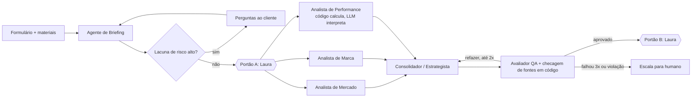

# Arquitetura do Sistema AX (resumo técnico)

Fonte completa e viva: [Sistema AX — Arquitetura v1](https://claude.ai/artifact/6QiT8NSaqqjj6f5iNkWDs9). Este arquivo resume o que o código implementa.

## Topologia

| Padrão | Onde |
|---|---|
| Workflow determinístico | esqueleto do ciclo: onboarding → briefing → análise → aprovação → execução → aprendizado |
| Orchestrator-Workers | um orquestrador por cliente chama os especialistas |
| Router | pedidos avulsos (fase 2) |
| Evaluator-Optimizer | Avaliador antes de cada aprovação humana, máximo de 2 refações |

## Piloto: Diagnóstico AX

## Prompt em camadas e cache

Ordem fixa, do mais estável ao mais variável:

1. **Método AX** (global) — system
2. **Minicérebro do agente** — system, *breakpoint de cache* (compartilhado entre clientes)
3. **Memória do cliente** (briefing aprovado) — system, *breakpoint de cache* (compartilhado entre os agentes daquele cliente)
4. **Trechos recuperados + dados externos** — mensagem do usuário, em tags XML, com tags neutralizadas
5. **Pedido** — mensagem do usuário

## Isolamento (três travas)

1. **Banco**: RLS em todas as tabelas por `tenant_id` e `client_id` vindos do JWT. Token de agente carrega um único `client_id`; só `ax_papel = membro` vê todos os clientes do tenant e só membro grava aprovação.
2. **Código**: `ContextoCliente` criado pelo orquestrador; `garantirMesmoCliente` falha alto (não filtra em silêncio).
3. **Conhecimento**: trecho com `client_id` nulo é do tenant; lição de cliente só sobe para o global anonimizada e aprovada.

## Modelos

| Papel | Agentes | Variável |
|---|---|---|
| padrão (barato) | Briefing, Analistas | `AX_MODELO_PADRAO` (default `claude-haiku-5-5`) |
| forte | Consolidador/Estrategista, Avaliador | `AX_MODELO_FORTE` (default `claude-sonnet-5-5`) |
